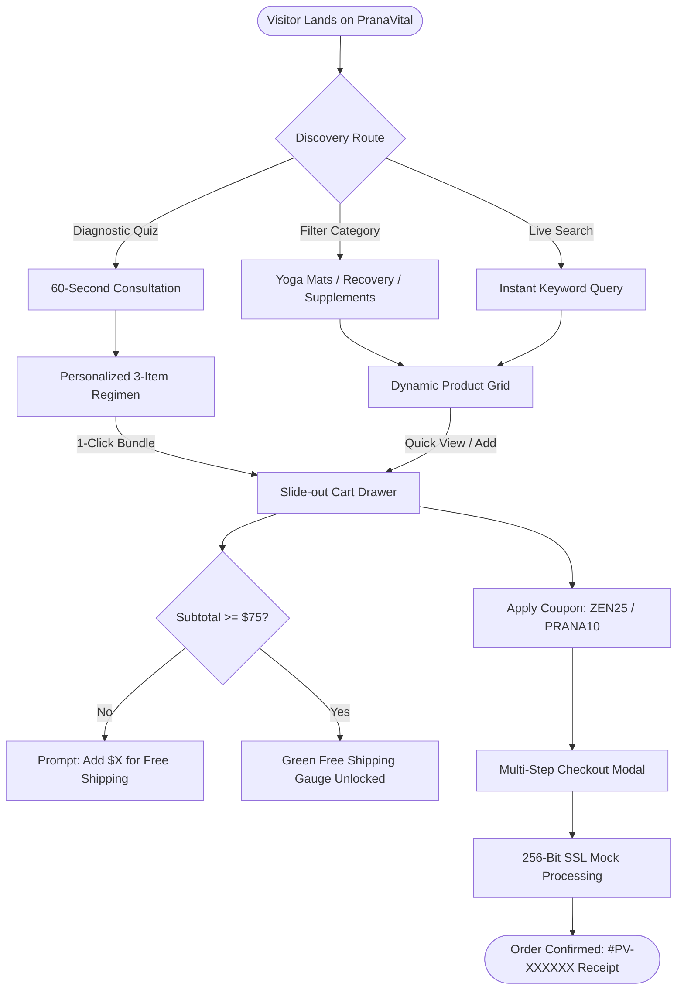

<div align="center">

# 🌿 PranaVital — Eco Yoga Mats & Healthcare Storefront
**A high-converting, accessible, and responsive e-commerce platform for mindful movement & holistic orthopedic wellness.**

[](LICENSE)
[](CONTRIBUTING.md)
[](#)
[](https://yadavaniket2212-crypto.github.io/pranavital-ecommerce/)

### 🌐 [Click Here to View Live Website: https://yadavaniket2212-crypto.github.io/pranavital-ecommerce/](https://yadavaniket2212-crypto.github.io/pranavital-ecommerce/)

[Architecture](docs/ARCHITECTURE.md) • [User Flows](docs/USER_FLOWS.md) • [Component Guide](docs/COMPONENT_GUIDE.md) • [Report Bug](.github/ISSUE_TEMPLATE/bug_report.md)

</div>

---

## 📖 Table of Contents
- [✨ Key Capabilities](#-key-capabilities)
- [🗺️ Customer Flow & Journey](#️-customer-flow--journey)
- [📁 Systematic Repository Structure](#-systematic-repository-structure)
- [🚀 Quick Start & Local Preview](#-quick-start--local-preview)
- [🩺 60-Second Diagnostic Quiz](#-60-second-diagnostic-quiz)
- [🎟️ Built-In Promotional Engine](#️-built-in-promotional-engine)
- [🐙 GitHub Setup & Push Instructions](#-github-setup--push-instructions)
- [🚀 Automated CI/CD & GitHub Pages Deployment](#-automated-cicd--github-pages-deployment)
- [🤝 Contributing](#-contributing)
- [📄 License](#-license)

---

## ✨ Key Capabilities

### 🧘 1. Dynamic Catalog & Smart Filtering
- **Curated Multi-Category Inventory**:
  - **Eco Yoga Mats**: 100% natural tree rubber with laser alignment lines, organic oak cork mats, ultra-light foldable travel mats.
  - **Spine & Recovery**: 8,000+ node acupressure spike mats, 4-level lumbar spine traction stretchers, 4-speed vibrating foam rollers, joint gel pads.
  - **Herbal Supplements**: Organic KSM-66 Ashwagandha, Turmeric Curcumin + Boswellia, Chelated Magnesium Glycinate sleep complex.
  - **Mindfulness & Props**: GOTS-certified organic buckwheat zafu pillows, botanical tea-tree mat sanitizer spray.
- **Real-Time Search & Sorters**: Instant keystroke search matching title, benefits, and materials, with sort by *Featured*, *Price: Low to High*, *Price: High to Low*, and *Highest Customer Rating*.

### 🛒 2. Reactive Cart & Free Shipping Meter
- **Slide-Out Cart Drawer**: Slide-out drawer with zero page redirects.
- **Dynamic Free Shipping Progress Gauge**: Visual progress bar tracking cart total against the **$75** free delivery threshold.
- **Persistent State**: Full cart and wishlist synchronization via `localStorage`.

### 🩺 3. Interactive Diagnostic Quiz
- 3-step interactive clinical wellness assessment addressing user discomfort, practice style, and material preferences.
- Recommends a targeted 3-item recovery bundle with a 1-click **"Add Entire Regimen (Save 20%)"** action.

### 💳 4. Seamless Multi-Step Checkout Simulation
- Complete address collection, mock encrypted card processing delay (1.2s), and celebratory order confirmation receipt with generated order tracking ID (`#PV-XXXXXX`).

---

## 🗺️ Customer Flow & Journey



---

## 📁 Systematic Repository Structure

The project is structured according to professional software development and open-source standards:

```text
pranavital-ecommerce/
├── .github/
│   ├── ISSUE_TEMPLATE/
│   │   ├── bug_report.md             # Standardized bug submission format
│   │   └── feature_request.md        # Feature suggestion proposal template
│   ├── workflows/
│   │   ├── code-quality.yml          # Automated CI linting and file integrity checks
│   │   └── deploy-pages.yml          # Automated 1-click GitHub Pages deployment
│   └── PULL_REQUEST_TEMPLATE.md      # Code review checklist for pull requests
├── assets/
│   ├── css/
│   │   └── styles.css                # Modular design system, glassmorphism & keyframes
│   ├── js/
│   │   ├── app.js                    # Modular application controller
│   │   └── data/
│   │       └── products.js           # Independent catalog data store
│   └── images/
│       └── favicon.svg               # Vector brand logo mark
├── docs/
│   ├── ARCHITECTURE.md               # Systematic architectural specification & state models
│   ├── USER_FLOWS.md                 # Visual Mermaid diagrams of all user journeys
│   └── COMPONENT_GUIDE.md            # Detailed schema and UI component documentation
├── .gitignore                        # Git exclusion rules for logs, OS, and editor files
├── CONTRIBUTING.md                   # Contributor code of conduct and workflow guidelines
├── LICENSE                           # Open-source MIT License
├── package.json                      # Repository metadata and validation scripts
├── README.md                         # Main repository guide
├── index.html                        # Production-ready storefront HTML5 root
├── server.ps1                        # Native Windows local development server
├── app.js                            # Standalone all-in-one controller
└── styles.css                        # Root CSS for direct execution
```

---

## 🚀 Quick Start & Local Preview

### Option A: Windows Native Server (Zero Install)
Run the included PowerShell server script:
```powershell
powershell -ExecutionPolicy Bypass -File .\server.ps1
```
Open **[http://localhost:8080/](http://localhost:8080/)** in your browser.

### Option B: Direct Double-Click
Double-click `index.html` in Windows File Explorer to open directly in any browser.

### Option C: Using Node.js or Python (Optional)
```bash
# Using Node
npx serve .

# Using Python
python -m http.server 8080
```

---

## 🩺 60-Second Diagnostic Quiz

The built-in quiz algorithm matches user pain points and movement habits to specific medical recovery and yoga equipment:

| User Target | Primary Recommendation | Complementary Gear | Focus |
| :--- | :--- | :--- | :--- |
| **Lumbar / Sciatica** | AcuRelief™ Acupressure Spikemat | BioSpine™ Back Stretcher + FlexiJoint™ | Spinal decompression |
| **Knee & Wrist Pain** | AuraGrip™ 5mm Pro Rubber Mat | ZenFlex™ Orthopedic Gel Knee Pads | Impact dampening |
| **Nocturnal Cramps / Insomnia** | DeepRest™ Magnesium Glycinate | AshwaCalm™ KSM-66 + AcuRelief™ | Cortisol & REM sleep |

---

## 🎟️ Built-In Promotional Engine

Test these coupons directly in the Cart Drawer:
- `ZEN25` — **25% OFF** across your entire cart.
- `PRANA10` — **10% OFF** welcome discount.
- `FREESHIP` — Automatically waives all shipping fees.

---

## 🐙 GitHub Setup & Push Instructions

To push this project to your own GitHub account:

### 1. Initialize Git in this directory:
```bash
git init
git add .
git commit -m "feat: initial commit of PranaVital e-commerce storefront"
```

### 2. Create a new repository on GitHub:
Go to [github.com/new](https://github.com/new) and create a repository named `pranavital-ecommerce`.

### 3. Connect your local repository and push:
```bash
git branch -M main
git remote add origin https://github.com/yadavaniket2212-crypto/pranavital-ecommerce.git
git push -u origin main
```

---

## 🚀 Automated CI/CD & GitHub Pages Deployment

This repository includes pre-configured GitHub Actions:

1. **Deploy to GitHub Pages (`.github/workflows/deploy-pages.yml`)**:
   - In your GitHub repo, go to **Settings > Pages**.
   - Under **Build and deployment > Source**, select **GitHub Actions**.
   - Every push to `main` will automatically build and publish your live website to `https://yadavaniket2212-crypto.github.io/pranavital-ecommerce/`.

2. **Code Quality & Link Validation (`.github/workflows/code-quality.yml`)**:
   - Validates HTML semantics, verifies asset integrity, and ensures zero broken links on every Pull Request.

---

## 🤝 Contributing

Contributions are welcomed! Please see our [**Contributing Guide**](CONTRIBUTING.md) and adhere to the [**PR Template**](.github/PULL_REQUEST_TEMPLATE.md).

---

## 📄 License

Distributed under the [MIT License](LICENSE). Copyright © 2026 PranaVital LLC.
