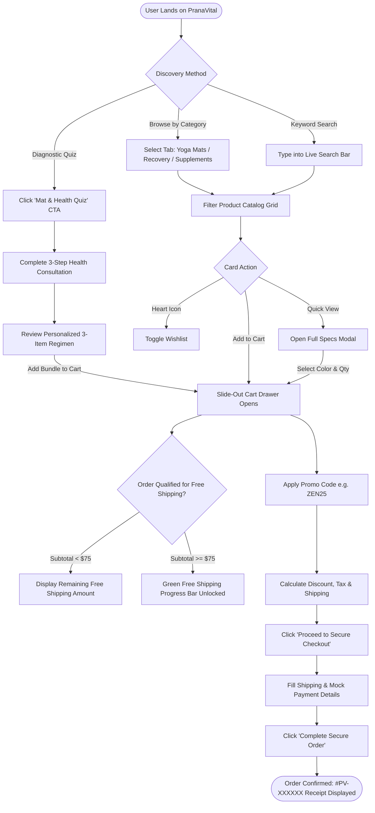
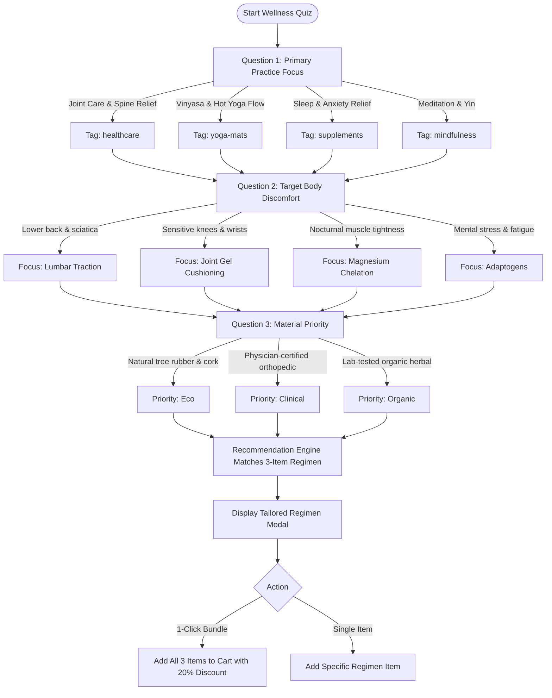
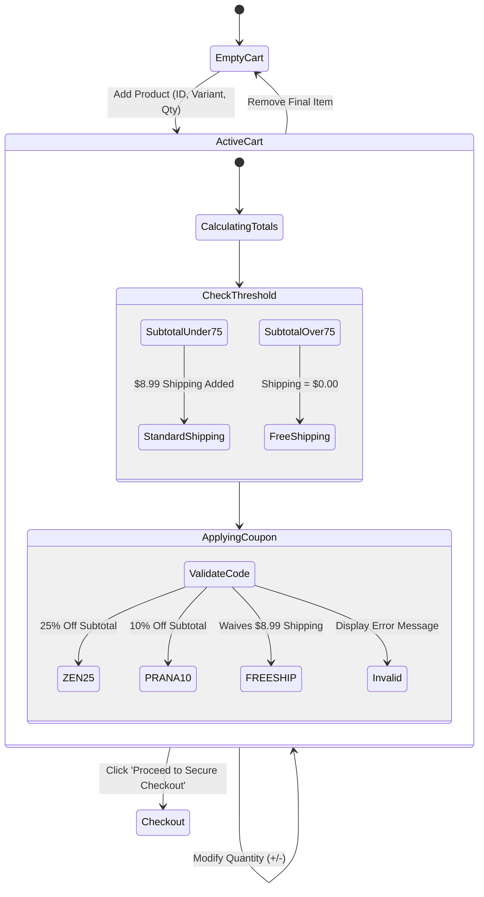
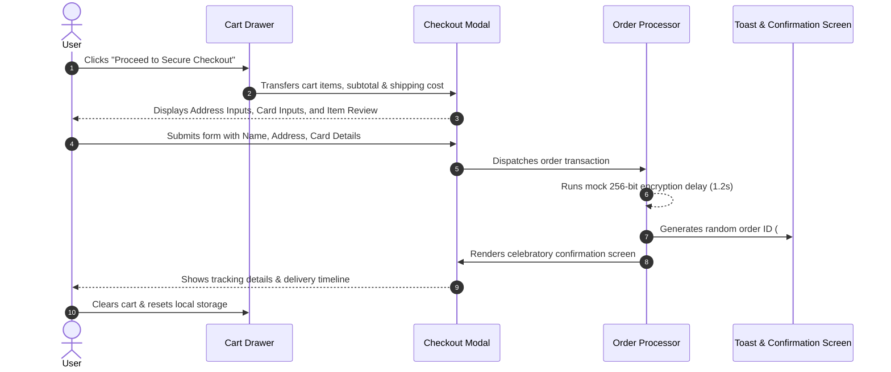

# 🗺️ PranaVital User & Data Flows

This document details the user journey workflows and state transition models across the platform using Mermaid diagrams.

---

## 1. End-to-End Customer Journey

---

## 2. Interactive 60-Second Diagnostic Quiz Flow

---

## 3. Cart & Promotional Engine State Machine

---

## 4. Multi-Step Checkout Flow

